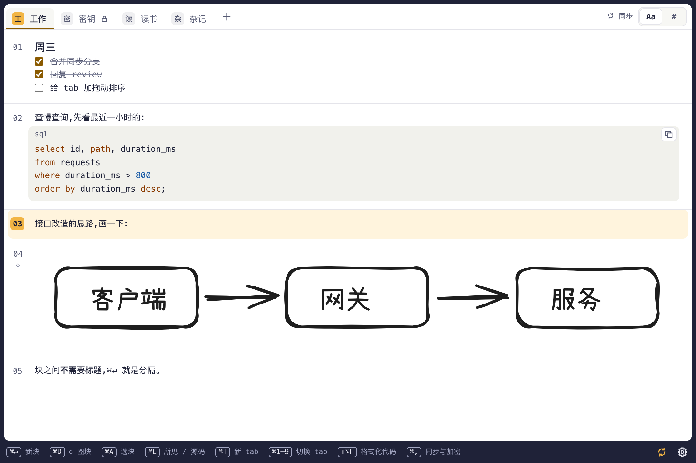

# 板儿(Baner)

一块超轻量的分块记事板。同页、无限、分块书写,支持图块、tab、按 tab 的 git 同步与端侧加密。数据就是你自己 git 仓库里的普通文件。

> 状态:MVP 开发中(macOS)。



## 特点

- **分块书写**:同一页一直往下写,`⌘↵` 新建块,`⌘A` 选中当前块。文本块按 Markdown 显示,所见与源码用 `⌘E` 切换;代码块带高亮和复制按钮,`⇧⌥F` 格式化。
- **图块**:`⌘D` 在页面里原地画图(Excalidraw),存成 `.excalidraw` 场景和 `.svg` 预览。
- **tab**:每个 tab 一个文件夹,可以单独决定同步与否、加密与否。
- **git 同步**:用 GitHub 登录,选一个你自己的仓库(只授权这一个),自动提交、合并、推送;有冲突不弹窗,冲突标记留在块里。
- **端侧加密**:加密 tab 的内容和名字在仓库里都是密文(age 格式),不用板儿也能用 `age` 命令行工具解开。
- **数据即文件**:文本块就是普通的 `.md` 文件,明文 tab 在 git 网页上直接能读。

## 下载

[下载最新版 `.dmg`](https://github.com/SandyKidYao/baner/releases/latest/download/Baner_macOS_universal.dmg)(macOS 11+,Apple 芯片与 Intel 通用),把 Baner 拖进「应用程序」;历史版本和更新说明在 [Releases](https://github.com/SandyKidYao/baner/releases)。0.1.1 起应用会自动检查新版本,在「⚙ → 版本」里一键更新并重启。这个版本是 ad-hoc 签名、没有公证,第一次打开时在「系统设置 → 隐私与安全性」里点「仍要打开」,或执行 `xattr -dr com.apple.quarantine /Applications/Baner.app`。

## 从源码跑起来(macOS)

需要 Node 22+、Rust stable、Xcode 命令行工具。先取得源码:

```bash
git clone https://github.com/SandyKidYao/baner.git && cd baner
```

然后:

```bash
npm install                    # 1. 安装依赖(同时启用提交前钩子)
npm run tauri dev              # 2. 启动开发版
```

自己打正式版:`scripts/install-app.sh`(release 构建、ad-hoc 签名、不公证,装到 `/Applications/Baner.app`)。本机构建的应用不带隔离标记,可以直接打开。

数据在 `~/Library/Application Support/dev.baner.app/`:`data/` 是数据目录(可以作为 git 仓库同步),`secrets.json` 和 `config.json` 只留在本机。

## 性能对比

```bash
scripts/perf/measure.sh /Applications/Baner.app=Baner /Applications/Heynote.app=Heynote
```

两个应用交替冷启动,记录从 `open` 到窗口出现的时间,以及静置后所有相关进程的内存(footprint)。

## 检查与测试

```bash
scripts/check.sh               # 全部:格式、lint、类型、Rust 测试、Vitest、Playwright
scripts/check.sh --fast        # 只做格式、lint、类型(提交前钩子用)
```

## 目录

| 目录 | 内容 |
|---|---|
| `src/` | 界面层(React + TypeScript + CodeMirror 6) |
| `crates/baner-core/` | 核心逻辑(纯 Rust):存储、加密、git 同步、本机密钥文件 |
| `src-tauri/` | Tauri 外壳,只注册命令 |
| `tests/e2e/` | 浏览器内的界面冒烟测试(核心层命令被模拟) |
| `scripts/` | 检查、安装、发版、性能测量脚本 |

## 文档

- [架构](docs/tech/architecture.md)与[架构决策记录](docs/tech/adr/README.md)
- [体验设计规范](docs/design/design.md)
- [工程约定](docs/dev/conventions.md)
- 给 AI 协作者的说明:[AGENTS.md](AGENTS.md)

## 许可证

[MIT](LICENSE)
